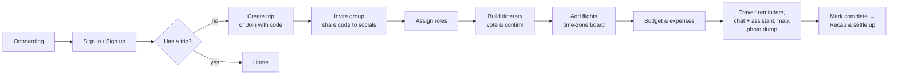
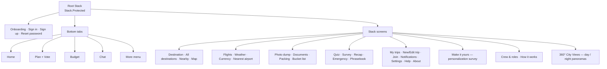
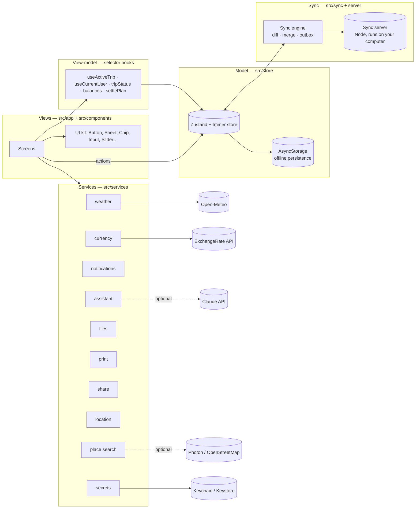
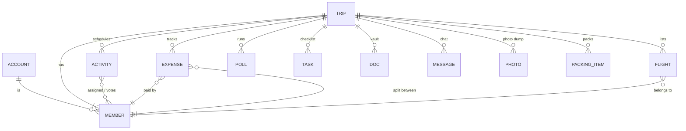

# TogetherWeGo — Planning documents

These are the planning artifacts behind the app (rating sheet: *Planning Process — tangible planning documents*).

## 1. Problem statement
Group trips fall apart in group chats: plans live in five apps, nobody knows who paid for what, flights land at different times in different time zones, and the one person with the booking PDF has no signal. **TogetherWeGo puts the whole trip — plan, money, people and paperwork — in one shared place that still works offline.**

## 2. Personas
| Persona | Needs | Features that serve them |
|---|---|---|
| **Maya, 17 — the organizer** | Get six friends to agree, keep everyone on schedule | Invite codes, roles, polls & activity voting, live reminders, printable planner |
| **Priya, 17 — the treasurer** | Track a shared budget fairly, settle up without awkwardness | Budget cap, multi-currency expenses, splits, fewest-payment settle-up |
| **Diego, 16 — the foodie** | Find great food nearby within budget | Nearby radius + price filter, budget finds, Trip Assistant “best food nearby?” |
| **Mr. Kim — a parent chaperone** | Know where everyone is, keep documents & emergency info handy | Flights & arrivals board, offline document vault, emergency numbers, location sharing |

## 3. User journey

## 4. Navigation map

## 5. Architecture

## 6. Data model

Key decisions:
- **Dates vs. instants.** Itinerary times are wall-clock times in the destination’s zone (`2026-10-06` + `14:30`), because that is how people plan. Flights are stored as UTC instants so they convert correctly to any time zone.
- **Money in one base currency.** Expenses are stored in USD (with the original amount kept) so totals and splits are always comparable; views convert to home or local currency.
- **Majority voting.** A “voting” activity becomes “confirmed” when more than half of members vote yes.
- **Exact money.** Splits and balances are calculated in whole cents, and the fewest-payments settle-up is solved exactly for groups up to 12 people, so the books always balance to the cent.
- **Passwords.** Salted PBKDF2-HMAC-SHA256, the round count stored with each hash so it can be raised later; older hashes are upgraded the next time someone signs in.
- **Sync.** Every field of a shared trip is a small register stamped by a hybrid logical clock; the newest stamp wins, so phones that have exchanged their changes hold identical trips whatever the order. Private data (Scout AI chat, other people's emails, flight tickets) is never sent. Details in `docs/SYNC.md`.

## 7. Feature priorities (MoSCoW)
| Must | Should | Could | Won’t (this version) |
|---|---|---|---|
| Trips + invite codes, roles, itinerary, voting, budget & splits, chat, flights & time zones, reminders, offline storage, validation | AI assistant, currency converter, weather, documents vault, map, nearby radius & filters, printable planner, social sharing | Quiz, survey recommendations, phrasebook TTS, recap, packing suggestions, emergency screen, 6 languages, personalization (themes, interests, home layout), animations, **live sync across phones** through a self-hosted server, invite QR codes | A hosted cloud service, accounts on a server, real Google OAuth, payments |

## 8. Accessibility & UX rationale
- Reference-matched visual language: cream canvas, forest-green primary, soft-green highlights, pill navigation — calm and readable outdoors.
- Every icon-only control has an `accessibilityLabel`; toggles expose checked/selected state; sliders are adjustable with screen readers.
- Text size setting (Default / Large / Extra large) on top of the phone’s own font scaling.
- Personalization: 6 themes in light, dark or follow-my-phone, three Home layouts, adjustable corner shapes, a celebration setting (Chill, Lively, Max) and an *Animations* switch for people sensitive to motion. The look is documented in `docs/DESIGN.md`.
- Errors appear inline under the field in red with a plain-language fix (“Codes look like ABC-1234”).
- Destructive actions always confirm; toasts confirm every successful action.
- **Kept simple.** Each form asks for the few things that matter and folds the rest under *More options* (adding an activity: where, which day, what time). The kind of activity and of expense is guessed from the words typed. *More* is one grid of big buttons, *Settings* keeps the technical switches under *Advanced*, and the Plan's kind and length filters open from one *Filter* button.
- **Place search privacy.** Typing in *Where do you want to go?* sends the words (and a map point rounded to about 1 km, around the trip or the phone when it is at the trip) to Photon, a free OpenStreetMap search. Nothing else is sent, there is no account, and the distances are worked out on the phone. With no connection the trip's saved places still match.

## 9. Test log

### 9a. Automated (`npm test`, runs in about 5 seconds)
| Area | What the tests prove |
|---|---|
| Money (`src/utils/__tests__/money.test.ts`) | Cents never drift (even 0.1 + 0.2), splits add up to the total with the odd cents handed out fairly, settle-up leaves every balance at zero, never needs more than (people − 1) payments on random groups, and finds fewer payments than the simple largest-first method when a group splits into pairs |
| Validation, time zones, passwords | Email/name/amount/date/invite/flight/IATA rules, daylight-saving edges, PBKDF2 against the RFC 7914 test vector, old hashes upgrade |
| Store (`src/store/__tests__`) | Sign-up/sign-in/reset, trips, joining, itinerary and voting, budget, polls, packing, photos, docs, attaching files, clearing sample data |
| Assistant | Local answers (budget, who owes who, currency, emergency numbers, places) and the Claude request: what is sent, the last 12 messages only, wrong key, refusal, empty answer, the 45-second limit |
| Sync (`src/sync/__tests__`, `server/__tests__`) | Merge convergence on 150 random three-phone runs, sharing and joining, offline queue, restart, private data, files, the real server over real HTTP, time limits, address parsing |
| Place search and guesses (`src/services/__tests__/placeSearch.test.ts`) | Saved places match by name and area, Photon answers become places (streets and bus stops dropped), the search looks around the trip first and anywhere if nothing is near, rounded point and box in the request, caching, time limit, cancel, merging without duplicates, activity and expense type guessed from words |
| 360° view on the phone's native animation driver (`src/components/panorama/__tests__`) | The screen does not crash when day/night and position share a view with looping lights (it did, on a real phone, before this test) |
| Invites and QR | Link round trip for every address form, QR codes that a decoder reads back |
| Home ranking, pretend friends, Reduce Motion | The "Picked for you" ranking, canned replies, the motion rule |

### 9b. Automated browser tests (`npm run e2e`, see `e2e/README.md`)
Eight scripts drive the web build in a phone-sized window: every main flow, the personalisation survey (including tapping a summary row to change an answer), the 360° views, Reduce Motion, a **sideways-overflow audit of every screen at 390 px, 320 px and with larger text**, a **no-button-inside-a-button audit** (the web warning *"`<button>` cannot contain a nested `<button>`"*), and a **two-phone sync run** against the real server (share, join, chat, expenses, offline catch-up, restart, a photo, a receipt and a PDF).

### 9c. Manual + earlier browser runs
| Area | Checks |
|---|---|
| Auth | Empty-field errors, wrong password, sign-up validation & strength meter, reset-code flow, old password rejected after reset |
| Plan | Add-activity validation, overlap warning, vote → auto-confirm, **Lock in** (organizer only), reminder toggle, edit, delete, category + time filters |
| Budget | Receipt attach, expense validation, who-owes-who, settle up, home/local currency view |
| 360° views | Drag/arrows/auto-rotate wrap past 0°, day/night toggle, landmark jump + facts, city picker, entry points (Home, destination, More) |
| Extras | Day/night hero toggle, Scout AI tab separate from the crew chat, packing assignment + fair split, first-run tour, story card |
| Budget | Amount validation, ¥ expense converted to USD, settle-up records payment, budget-cap validation |
| Collaboration | Join with empty/unknown/valid code, add-member validation (name, email), polls (vote, close), checklist add + empty-task error |
| Flights | Missing-field errors, unknown IATA rejected, flight saved, time-zone toggle |
| Personalization | Survey requires ≥1 interest, nickname length check, theme/corner choice survives restart, sign-in kept across the theme reload, Explore sections hide/show, “Picked for you” ranking |
| Platform | `tsc --noEmit` (strict) ✔, ESLint 0 problems ✔, iOS and Android bundles compile ✔, `expo prebuild` produces the native projects with the local-network and camera settings ✔ |
| Not run on a physical phone | On-device file upload/download, the camera QR scanner and "share as picture" (they are native-only; everything around them is covered above) |
